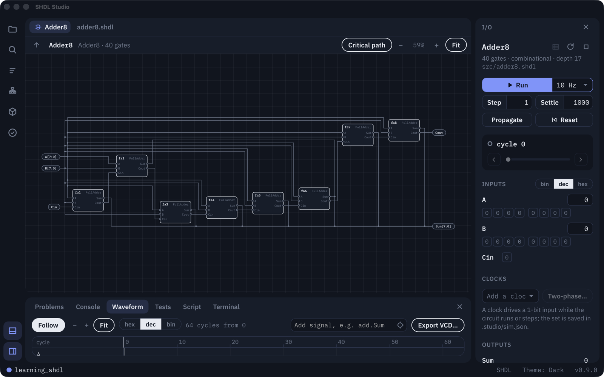

# SHDL

SHDL (Simple Hardware Description Language) is an educational, gate-level hardware description
language. You describe hardware out of AND, OR, NOT and XOR gates and watch signals ripple through
it. Circuits simulate gate by gate, one propagation level per cycle (the unit-delay model), and no
tool in the chain is allowed to collapse or shortcut that structure.



## Get started

- **[SHDL Studio](https://github.com/rafa-rrayes/SHDL/releases/tag/studio-v0.9.0)**: the desktop
  app, with the editor, simulator, schematic, waveforms and tests in one window. Download the DMG
  for macOS (Apple Silicon and Intel). It needs no Python and no command line.
- **[PySHDL](pyshdl/)**: the toolchain as a Python package, with the `shdl` command for projects
  and packages. `uv tool install --python 3.14 PySHDL` (or `pip install PySHDL`).
- **[Documentation](https://rafa-rrayes.github.io/SHDL/)**: a guided tour, the language
  reference and the tools.

## A taste of SHDL

```shdl
component HalfAdder(A, B) -> (Sum, Carry) {
    x1: XOR;  a1: AND;

    connect {
        A -> x1.A;  B -> x1.B;  x1.O -> Sum;
        A -> a1.A;  B -> a1.B;  a1.O -> Carry;
    }
}

top component FullAdder(A, B, Cin) -> (Sum, Cout) {
    ha1: HalfAdder;     # A + B
    ha2: HalfAdder;     # (A + B) + Cin
    o1:  OR;            # carry out if either stage carried

    connect {
        A       -> ha1.A;   B   -> ha1.B;
        ha1.Sum -> ha2.A;   Cin -> ha2.B;
        ha2.Sum -> Sum;

        ha1.Carry -> o1.A;  ha2.Carry -> o1.B;
        o1.O -> Cout;
    }
}
```

[`examples/`](examples/) is a graded tour, from a single gate to a parameterized ALU, followed by
SR16 (a 16-bit CPU built from primitive gates) and Conway's Game of Life.

## In this repository

| Path | What it is |
|---|---|
| [`pyshdl/`](pyshdl/) | The toolchain: the flattener (SHDL → Base SHDL), the shdlc compiler (Base SHDL → C), the `Circuit` Python driver, the `shdl` CLI, the conformance suite and the tests |
| [`examples/`](examples/) | The learning path, the SR16 CPU and Game of Life |
| [`docs/`](docs/) | The normative [specs](docs/specs/) and the verification map, and the [documentation site](docs/website/) |

SHDL Studio's installers are published on this repository's
[releases](https://github.com/rafa-rrayes/SHDL/releases), and packages for the `shdl` CLI come
from [Circuit Circus](https://rafa-rrayes.github.io/CCircus), the SHDL package index.

## License

[GPL-3.0-or-later](LICENSE).
